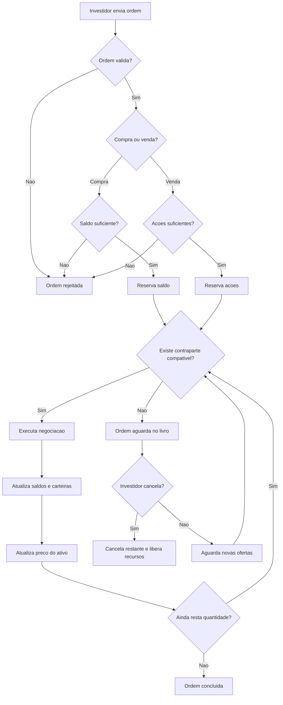

# Regras do Mercado

## 📌 Objetivo

Este documento define as regras de negócio que governam o funcionamento do mercado financeiro simulado. Ele serve como referência única para a implementação do Matching Engine e dos demais componentes do sistema (carteira, ordens, preços).

---

## 1. Capital Inicial

- Todo investidor começa a simulação com um **saldo inicial em dinheiro (caixa)** fixo e igual para todos.
- Valor padrão: **R$ 10.000,00** (pode ser ajustado depois, mas deve ser o mesmo para todos os investidores em uma mesma simulação).
- O investidor **não pode operar com valor negativo de caixa** em nenhuma hipótese.
- O investidor **recebe uma quantidade inicial de ações fictícias, definida na configuração da simulação.** 

---

## 2. Ativos Negociáveis

- O mercado simulado negocia um conjunto fixo e pré-definido de ativos (ex.: ações fictícias como `AAA3`, `BBB4`, `CCC3`).
- Cada ativo possui:
  - **Código/ticker** (identificador único, ex.: `AAA3`);
  - **Preço atual** (atualizado a cada negociação executada);
  - **Preço inicial**, definido no começo da simulação.
- A lista de ativos permanece fixa durante a simulação.
- Cada ativo possui uma quantidade total definida inicialmente, distribuída entre os investidores.
- A quantidade total de ações de cada ativo permanece constante durante a simulação. As negociações apenas transferem ações entre investidores.
- Os ativos podem ser negociados em quantidades inteiras positivas.

---

## 3. Investidores (Jogadores)

- Cada investidor é identificado por um ID único.
- Cada investidor possui:
  - **Saldo em caixa** (dinheiro disponível);
  - **Carteira de ativos** (quantidade de cada ativo que possui).
- Um investidor só pode enviar ordens em seu próprio nome (não pode operar em nome de outro).

---

## 4. Tipos de Ordens Suportadas

Para manter o sistema simples, o mercado suporta apenas dois tipos de ordem: Compra e venda.

| Tipo | Descrição |
|------|-----------|
| **Compra** |  investidor informa quantas ações deseja comprar e o preço máximo que aceita pagar por ação. |
| **Venda** | o investidor informa quantas ações deseja vender e o preço mínimo que aceita receber por ação. |

Toda ordem deve conter:

- Identificador único da ordem;
- Identificador do investidor;
- Código do ativo;
- Operação: compra ou venda;
- Quantidade inteira positiva;
- Preço por ação, obrigatório e maior que zero;
- Data e hora de recebimento, ou sequência de chegada atribuída pelo servidor.

---

## 5. Regras de Compra

- O investidor deve possuir saldo suficiente para comprar a quantidade solicitada pelo preço informado
- O sistema calcula o valor necessário: `quantidade × preço`
- Se o saldo disponível for insuficiente, a ordem é rejeitada
- Se houver saldo suficiente, o valor é reservado para a ordem
- Quando a compra é executada, o valor negociado é debitado e as ações são adicionadas à carteira do comprador
- Se a compra for parcialmente executada, o saldo correspondente à quantidade restante continua reservado
- Se o preço executado for menor que o informado, a diferença é liberada
- Ao cancelar a ordem, o saldo reservado para a quantidade não executada é liberado
---

## 6. Regras de Venda

- O investidor só pode vender ações que possui
- A quantidade disponível deve ser suficiente para atender à ordem
- Ações reservadas em outras ordens não podem ser utilizadas
- Se a quantidade disponível for insuficiente, a ordem é rejeitada
- Ao aceitar uma ordem, o sistema reserva as ações solicitadas
- Quando a venda é executada, as ações negociadas são retiradas da carteira do vendedor e o valor correspondente é creditado ao saldo
- Em execuções parciais, as ações restantes continuam reservadas
- Ao cancelar a ordem, as ações não negociadas são liberadas

---

## 7. Execução de Ordens (Matching)

O mercado utiliza um **Livro de Ofertas**, que armazena as ordens de compra e venda pendentes.

O **Matching Engine** é responsável por encontrar ordens compatíveis e executar negociações.

### 7.1. Prioridade das ordens

As ordens seguem a prioridade de preço e tempo:

- Compras com maior preço têm prioridade
- Vendas com menor preço têm prioridade
- Em caso de preços iguais, a ordem recebida primeiro tem prioridade

### 7.2. Compatibilidade

Uma negociação acontece quando:

`preço de compra >= preço de venda`

**Exemplo:** um investidor deseja comprar por R$ 100 e outro deseja vender por R$ 95. As ordens são compatíveis.

### 7.3. Preço de execução

- O preço da negociação corresponde ao preço da ordem que já estava registrada no Livro de Ofertas
- O preço atual do ativo é atualizado após cada negociação

### 7.4. Execução parcial

- Uma ordem pode ser executada totalmente ou parcialmente
- Uma ordem pode negociar com diferentes contrapartes
- A quantidade não executada permanece no Livro de Ofertas
- Saldos, carteiras e reservas são atualizados após cada negociação

### 7.5. Consistência

- Um investidor não pode negociar com suas próprias ordens
- O mesmo saldo ou ação não pode ser utilizado em duas ordens simultâneas
- Cada negociação possui um identificador único
- As atualizações de saldo, carteira e ordens devem ocorrer de forma consistente, mesmo com vários investidores operando simultaneamente

---

## 8. O que acontece quando não existe contraparte

Quando não existe uma ordem compatível:

- A ordem permanece aguardando no Livro de Ofertas
- O saldo ou as ações necessários continuam reservados
- A ordem poderá ser executada quando surgir uma contraparte compatível
- O investidor poderá cancelar a quantidade ainda pendente
- Ao cancelar, os recursos reservados para a quantidade não executada são liberados

O mercado permanece aberto enquanto a simulação estiver em execução, sem horário de fechamento.

---

## 9. Regras de Atualização de Preços

- O preço atual de um ativo corresponde ao preço da última negociação executada
- Antes da primeira negociação, o preço atual corresponde ao preço inicial
- Ordens pendentes não alteram o preço atual
- O preço é atualizado somente quando uma negociação acontece
- Eventos econômicos simulados podem influenciar as ordens enviadas pelos investidores automatizados, mas não alteram diretamente o preço

---

## 10. Restrições Operacionais

| Situação | Regra |
|---|---|
| Saldo insuficiente para compra | Rejeitar a ordem |
| Ações insuficientes para venda | Rejeitar a ordem |
| Quantidade zero ou negativa | Rejeitar a ordem |
| Preço-limite zero ou negativo | Rejeitar a ordem |
| Ativo inexistente | Rejeitar a ordem |
| Investidor inexistente ou não autorizado | Rejeitar a ordem |
| Recursos reservados em outras ordens | Impedir sua utilização |
| Negociação entre ordens do mesmo investidor | Não permitir |
| Cancelamento de ordem totalmente executada | Não permitir |
| Cancelamento de ordem parcialmente executada | Cancelar somente a quantidade restante |
---

## 11. Fluxo Simplificado de Negociação

**Observação:** o fluxograma representa o processamento básico das ordens. O cancelamento manual de ordens limitadas pendentes e o controle de concorrência são tratados pelas regras da documentação.

---

## 12. Configurações da Simulação

O sistema permite configurar:

- Lista de ativos fictícios, com três a cinco ativos
- Quantidade de investidores
- Capital inicial dos investidores
- Preço inicial dos ativos
- Quantidade inicial de ações distribuídas
- Parâmetros dos investidores automatizados

O mercado permanece aberto durante toda a execução da simulação.

## 13. Resumo das Perguntas-Chave

- **Como um investidor compra um ativo?** Enviando uma ordem de compra; o sistema reserva o saldo necessário e tenta casar a ordem com uma venda compatível (seção 5 e 7).
- **Como um investidor vende um ativo?** Enviando uma ordem de venda; o sistema reserva o ativo necessário e tenta casar a ordem com uma compra compatível (seção 6 e 7).
- **Quando uma ordem pode ser executada?** Quando existe uma ordem compatível na outra ponta (preço de compra ≥ preço de venda), respeitando a prioridade de preço e tempo (seção 7).
- **O que acontece quando não existe contraparte?** Quando não existe contraparte compatível, a ordem permanece aguardando no Livro de Ofertas até ser executada ou cancelada pelo investidor.
- **Como é tratado saldo insuficiente?** A ordem de compra é rejeitada antes de entrar no mercado (seção 10).
- **Como é tratado ativo insuficiente?** A ordem de venda é rejeitada antes de entrar no mercado; não há venda a descoberto (seção 10).