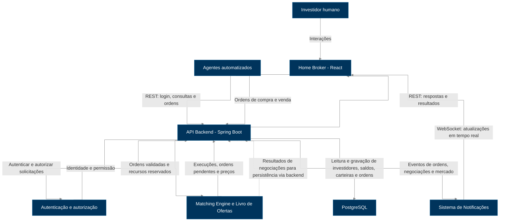

# Diagrama de Arquitetura da Solução

## 1. Objetivo

Descrever a **arquitetura lógica planejada** do Simulator, seus componentes, responsabilidades e fluxos de comunicação. 

## 2. Visão geral

> O diagrama representa **componentes lógicos**, não microsserviços independentes. O Matching Engine, a autenticação e as notificações podem integrar o mesmo backend Spring Boot. A separação física não está definida nesta etapa.

## 3. Componentes e responsabilidades

| Componente | Entrada | Responsabilidade | Saída |
|---|---|---|---|
| **Home Broker (React)** | Ações do investidor e eventos WebSocket | Exibir mercado, carteira e operações; permitir envio de ordens | Requisições REST à API |
| **API Backend (Spring Boot)** | Requisições REST e ordens dos agentes | Autenticar, autorizar, validar e coordenar operações | Respostas, ordens para processamento, dados persistidos e eventos |
| **Matching Engine / Livro de Ofertas** | Ordens validadas | Organizar ofertas, aplicar prioridade preço-tempo e casar ordens compatíveis | Negociações executadas, execuções parciais e ordens pendentes |
| **Banco de Dados (PostgreSQL)** | Operações de gravação e consulta do backend | Persistir o estado relevante da simulação | Dados recuperados para o backend |
| **Agentes Automatizados** | Estado do mercado e parâmetros da simulação | Gerar ordens segundo estratégias configuradas | Ordens encaminhadas à API |
| **Sistema de Notificações** | Eventos produzidos pelo backend | Encaminhar atualizações aos clientes conectados | Mensagens WebSocket para o Home Broker |

## 4. Fluxos principais

### 4.1. Autenticação e autorização

1. O investidor inicia uma sessão pelo Home Broker, que envia a solicitação à API via REST.
2. O backend identifica o investidor e verifica sua autorização.
3. A API responde ao Home Broker. Ordens posteriores devem ser associadas ao investidor autenticado, sem permitir operações em nome de terceiros.

> O mecanismo concreto de autenticação e gerenciamento de sessões será definido na implementação; este diagrama não pressupõe JWT, OAuth ou outro mecanismo específico.

### 4.2. Envio e execução de ordens

1. O Home Broker ou um agente automatizado envia uma ordem de compra ou venda à API.
2. O backend valida investidor, ativo, quantidade, preço e disponibilidade de saldo ou ações, reservando os recursos necessários.
3. A ordem segue para o Livro de Ofertas / Matching Engine, que aplica prioridade **preço-tempo** e procura contraparte compatível.
4. Havendo negociação, o sistema atualiza ordens, reservas, saldos, carteiras e preço do ativo de maneira consistente. Sem contraparte, a ordem permanece pendente; execuções parciais preservam a quantidade restante.
5. O backend coordena a persistência e a emissão dos eventos resultantes.

**Regras essenciais:** compra exige saldo suficiente; venda exige ações disponíveis; não são permitidas negociações consigo mesmo nem reutilização de recursos reservados. O preço executado é o da ordem que já estava no Livro de Ofertas.

### 4.3. Persistência

- O backend consulta e grava no PostgreSQL os dados relevantes da simulação, como investidores, ativos, saldos, carteiras, ordens e negociações.
- As atualizações de uma negociação devem preservar a consistência dos recursos e do estado, inclusive sob concorrência.
- O desenho detalhado das transações, do modelo de dados e da recuperação após falhas pertence às etapas específicas de persistência e consistência.

### 4.4. Notificações em tempo real

1. Alterações relevantes, como execução de ordens e atualização de preços, produzem eventos no backend.
2. O Sistema de Notificações recebe esses eventos e os encaminha por **WebSocket** aos clientes conectados.
3. O Home Broker atualiza a interface sem exigir recarregamento da página.

## 5. Tecnologias e limites

- **Frontend:** React.
- **Backend:** Spring Boot, com API REST e comunicação WebSocket.
- **Persistência:** PostgreSQL, Spring Data JPA / Hibernate e Flyway.
- **Infraestrutura prevista:** Docker e Docker Compose.
- **Documentação da API:** OpenAPI 3 / Swagger UI.

A implementação e a topologia de implantação podem evoluir, desde que respeitem as decisões arquiteturais documentadas. O documento de decisões prevê Java 21, enquanto o `backend/pom.xml` consultado configura Java 17; essa divergência deve ser resolvida separadamente.

## 6. Referências

- [Issue #5 — ARCH-002](https://github.com/nataliassantoz/Distributed-Stock-Exchange-Simulator/issues/5)
- [Decisões tecnológicas](technology-decisions.md)
- [Regras do mercado](../01-business/market-rules.md)
- [Ativos e investidores](../01-business/assets-and-investors.md)

> **Artefato complementar da issue:** `architecture-diagram.png`, a ser exportado a partir do diagrama Mermaid após revisão.