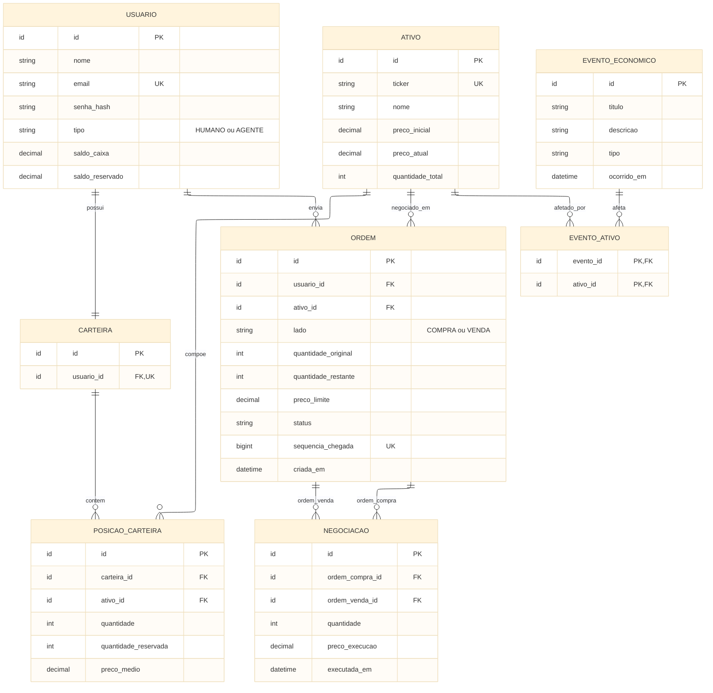

# DER — Modelo de Dados do Simulador

## 1. Objetivo

Definir a modelagem lógica relacional do **Distributed Stock Exchange Simulator**, incluindo entidades, atributos, chaves, relacionamentos e restrições de integridade. Este documento orienta a futura implementação no **PostgreSQL** com **Spring Data JPA/Hibernate** e **Flyway**; não representa tabelas já implementadas.

## 2. Diagrama Entidade-Relacionamento

> `POSICAO_CARTEIRA` resolve a relação N:N entre carteiras e ativos. `EVENTO_ATIVO` é uma associação **proposta** para eventos direcionados a ativos; eventos gerais podem existir sem associações. A regra de influência dos eventos sobre agentes será definida na implementação.

## 3. Entidades e atributos

| Entidade | Finalidade | Chave primária | Chaves estrangeiras |
|---|---|---|---|
| `USUARIO` | Investidores humanos e automatizados, identificação e caixa | `id` | — |
| `CARTEIRA` | Carteira individual do investidor | `id` | `usuario_id` |
| `ATIVO` | Ações fictícias negociáveis e seus preços | `id` | — |
| `POSICAO_CARTEIRA` | Quantidade, reserva e preço médio por ativo na carteira | `id` | `carteira_id`, `ativo_id` |
| `ORDEM` | Solicitação de compra ou venda e seu estado | `id` | `usuario_id`, `ativo_id` |
| `NEGOCIACAO` | Execução entre uma ordem compradora e uma vendedora | `id` | `ordem_compra_id`, `ordem_venda_id` |
| `EVENTO_ECONOMICO` | Notícia ou acontecimento econômico simulado | `id` | — |
| `EVENTO_ATIVO` | Associação opcional de eventos a ativos | `(evento_id, ativo_id)` | `evento_id`, `ativo_id` |

**Tipos sugeridos para PostgreSQL:** `ID` para identificadores, `NUMERIC(19,2)` para dinheiro/preços, `INTEGER` para quantidades, `BIGINT` para sequência e `TIMESTAMPTZ` para instantes. Os tipos de `status`, `lado` e `tipo` poderão ser definidos como texto com `CHECK` ou enumeração na implementação.

## 4. Relacionamentos e cardinalidades

| Relacionamento | Cardinalidade | Regra |
|---|---|---|
| Usuário → Carteira | 1:1 | Cada usuário possui uma carteira; `usuario_id` é único. |
| Usuário → Ordem | 1:N | Um usuário pode emitir várias ordens; cada ordem tem um proprietário. |
| Carteira → Posição | 1:N | Uma carteira pode conter várias posições, uma por ativo. |
| Ativo → Posição | 1:N | Um ativo pode estar em várias carteiras. |
| Carteira ↔ Ativo | N:N | Relação materializada por `POSICAO_CARTEIRA`. |
| Ativo → Ordem | 1:N | Cada ordem negocia exatamente um ativo. |
| Ordem de compra → Negociação | 1:N | Uma compra pode gerar várias execuções parciais. |
| Ordem de venda → Negociação | 1:N | Uma venda pode gerar várias execuções parciais. |
| Evento econômico ↔ Ativo | N:N opcional | Relação materializada por `EVENTO_ATIVO`; eventos gerais não exigem ativo associado. |

## 5. Integridade e regras de negócio

1. **Unicidade:** `USUARIO.email`, `ATIVO.ticker`, `CARTEIRA.usuario_id` e `ORDEM.sequencia_chegada` são únicos. Em `POSICAO_CARTEIRA`, o par `(carteira_id, ativo_id)` é único.
2. **Valores válidos:** preços e quantidades de ordens devem ser positivos; saldos, reservas, quantidades de posição e quantidade restante não podem ser negativos. `quantidade_restante <= quantidade_original`.
3. **Reservas:** `saldo_reservado <= saldo_caixa` e `quantidade_reservada <= quantidade`. Saldo disponível = `saldo_caixa - saldo_reservado`; ações disponíveis = `quantidade - quantidade_reservada`.
4. **Negociações:** `ordem_compra_id` e `ordem_venda_id` são diferentes; a primeira deve ser de compra e a segunda de venda, do mesmo ativo e de usuários distintos. Quantidade e preço executados devem ser positivos. As validações entre registros exigem lógica transacional, não apenas `CHECK`.
5. **Execuções parciais:** uma ordem pode participar de várias negociações. A soma das quantidades executadas não pode ultrapassar `quantidade_original`; a quantidade restante e o status devem refletir as execuções e cancelamentos.
6. **Preço do ativo:** `preco_atual` inicia com `preco_inicial` e muda somente após negociação, usando o preço da ordem já presente no livro de ofertas, conforme as regras do mercado.
7. **Conservação de ações:** a soma das posições dos investidores para cada ativo deve corresponder a `quantidade_total`, após a distribuição inicial; negociações apenas transferem posições.
8. **Exclusão e histórico:** não excluir em cascata ordens e negociações históricas. A política de exclusão de usuários e ativos deve preservar referências e rastreabilidade.
9. **Concorrência:** validação, reserva, execução e atualização de ordens, saldos e carteiras devem ocorrer em transações consistentes, com estratégia de bloqueio/isolamento definida na implementação. O DER, isoladamente, não elimina condições de corrida.

## 6. Decisões e limites

- **Saldo:** modelado em `USUARIO` para manter o escopo simples; uma entidade separada de conta financeira poderá ser avaliada futuramente.
- **Investidores automatizados:** representados por `USUARIO.tipo = AGENTE`, com perfil opcional (`CONSERVADOR`, `MODERADO`, `AGRESSIVO`), sujeitos às mesmas regras de negociação. string perfil_agente "opcional"
- **Ordem:** `sequencia_chegada` registra a prioridade temporal atribuída pelo servidor; preço e sequência orientam o futuro Matching Engine.
- **Eventos econômicos:** armazenados para rastreabilidade, sem alteração direta de preços; podem influenciar decisões dos agentes.
- **Fora do escopo desta issue:** scripts SQL, migrations Flyway, classes JPA, repositories, autenticação efetiva e implementação do Matching Engine.

## 7. Referências

- [Issue #6 — DB-001](https://github.com/nataliassantoz/Distributed-Stock-Exchange-Simulator/issues/6)
- [Regras do mercado](../01-business/market-rules.md)
- [Ativos e investidores](../01-business/assets-and-investors.md)
- [Diagrama de arquitetura](../02-architecture/architecture-diagram.md)
- [Decisões tecnológicas](../02-architecture/technology-decisions.md)

**Artefato complementar exigido pela issue:** exportar o diagrama Mermaid acima para `docs/03-database/der.png` após revisão.